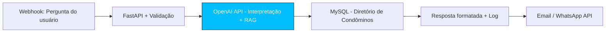

# Agente Toqan - Exemplo RAG - Barra Space Center

> Agente de consulta ao diretório de empresas condôminas usando RAG simples. Inspirado no padrão de orquestração da plataforma Toqan do iFood: Webhook -> LLM -> Base de dados -> Resposta automática.

Este projeto complementa o [Barra Space Center](https://github.com/Pedro274-ctrl/barraspace) adicionando camada de IA para consulta em linguagem natural.

**Status:** Em desenvolvimento 

---

## Problema

No Barra Space Center, o diretório de empresas tem busca por filtros, mas exige navegação manual. Perguntas como "Quais empresas de tecnologia estão ativas?" ou "Mostra contato da empresa X" ainda dependem de busca manual.

## Solução

Agente que recebe pergunta em linguagem natural via webhook, usa OpenAI API para interpretar intenção, faz busca RAG no MySQL/PostgreSQL no diretório de condôminos e retorna resposta automática via API (pronto para integrar com Email/WhatsApp).

Fluxo no padrão Toqan:



## Tecnologias

- **Backend:** Python, FastAPI, REST API
- **IA:** OpenAI API, Prompt Engineering, RAG simples com busca no banco
- **Banco:** MySQL (compatível com schema do Barra Space Center) / PostgreSQL
- **Automação:** Pronto para orquestração com n8n, Make, Zapier
- **Outros:** python-dotenv, mysql-connector-python

## Estrutura

```
agente-toqan-ifood-exemplo/
├── app.py                 # FastAPI + endpoint /consulta
├── requirements.txt        # Dependências
├── .env.example           # Modelo de variáveis de ambiente
├── .env                   # Local (ignorado pelo Git)
├── banco_exemplo.sql      # Exemplo de tabela condôminos para teste
├── test_request.json      # Exemplo de payload para teste
└── README.md
```

## Como rodar localmente

### Requisitos

- Python 3.10+
- MySQL ou PostgreSQL com tabela de condôminos (pode usar `banco.sql` do Barra Space)
- Chave OpenAI API

### Instalação

```bash
# 1. Clonar
git clone https://github.com/Pedro274-ctrl/agente-toqan-ifood-exemplo.git
cd agente-toqan-ifood-exemplo

# 2. Criar venv
python -m venv venv
source venv/bin/activate  # Linux/Mac
venv\Scripts\activate  # Windows

# 3. Instalar dependências
pip install -r requirements.txt

# 4. Configurar .env
cp .env.example .env
# Edite: OPENAI_API_KEY, DB_HOST, DB_NAME, DB_USER, DB_PASS

# 5. Rodar API
uvicorn app:app --reload --port 8000
```

API sobe em `http://localhost:8000`

Documentação automática: `http://localhost:8000/docs`

## Exemplo de uso

**Request:**

```json
POST /consulta
{
  "pergunta": "Quais empresas de tecnologia estão ativas no Barra Space?",
  "usuario": "pedro@exemplo.com"
}
```

**Resposta:**

```json
{
  "pergunta": "Quais empresas de tecnologia estão ativas no Barra Space?",
  "resposta": "Encontrei 3 empresas de tecnologia ativas: Empresa A - Sala 101, Empresa B - Sala 205...",
  "fontes": ["condominos.id 12, 15, 23"],
  "tempo_ms": 1240
}
```

**Teste via curl:**

```bash
curl -X POST http://localhost:8000/consulta \
  -H "Content-Type: application/json" \
  -d @test_request.json
```

## Integração com n8n (próximo passo)

Este agente foi desenhado para ser orquestrado via n8n:

```
Webhook n8n (pergunta) -> HTTP Request para /consulta -> If (tem resultado) -> Email/WhatsApp API
```

Export do workflow n8n será adicionado em `n8n-workflow-barra-space` repo.

## Segurança

- Variáveis sensíveis em .env (ignorado pelo Git)
- Consultas parametrizadas com mysql-connector (proteção SQL Injection)
- Validação de payload com Pydantic
- Chave OpenAI nunca versionada

## Roadmap

- [x] FastAPI com endpoint /consulta
- [x] Integração OpenAI API + busca MySQL
- [x] RAG simples no diretório de condôminos
- [ ] Adicionar embeddings com LlamaIndex para busca vetorial
- [ ] Workflow n8n completo com Email/WhatsApp
- [ ] Deploy com Docker

## Autor

Pedro Henrique Costa Santos
Engenharia de Software - Estácio - 4º semestre - Conclusão Out/2028
GitHub: @Pedro274-ctrl | LinkedIn: pedro-henrique-costa-0a8648260
Marinha do Brasil - Analista de Suporte de Sistemas - Linux Debian/LAMP 99% uptime

Projeto criado como demonstração de construção e operacionalização de modelos com ênfase em LLMs.
