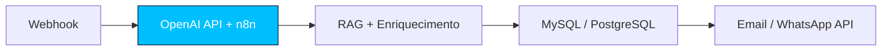

<p align="center">
  
</p>

<p align="center">
  <a href="https://www.linkedin.com/in/pedro-henrique-costa-0a8648260"></a>
  <a href="mailto:pedro274.phh@gmail.com"></a>
  <a href="https://github.com/Pedro274-ctrl"></a>
</p>

---

```javascript
const pedro = {
  formação: "Eng. Software - Estácio - 4º semestre - conclusão Out/2028",
  trabalho: "Analista de Suporte de Sistemas - Marinha - Mar/2022 até hoje",
  infra: "Linux Debian, LAMP, DNS, DHCP, iptables, Samba 4, Squid, FTP, IredMail - 99% uptime",
  código: "PHP + APIs Email/WhatsApp, MySQL, PDO, RBAC, React, Node, REST",
  ia: "Python, FastAPI, OpenAI API, RAG, Prompt Engineering",
  conquista: "1º Lugar - Formação de Fuzileiros Navais"
}
```

---

### Como eu construo



Ferramentas internas deployadas, não protótipos. Backend + frontend + banco + automação conectados.

---

### Stack

<p align="center">
  
</p>

<p align="center">
  
  
  
  
  
</p>

---

### Projetos

**[Agente Toqan - RAG no Diretório do Barra Space Center](https://github.com/Pedro274-ctrl/agente-toqan-ifood-exemplo)**
Camada de IA sobre o diretório de empresas do Barra Space Center, no padrão de orquestração do Toqan (iFood): Webhook → LLM → Banco → Resposta. Recebe perguntas em linguagem natural ("quais empresas de tecnologia estão ativas?"), busca o contexto no MySQL e gera a resposta com a OpenAI API, restrita ao que existe no diretório e com as fontes (IDs) e o tempo de resposta. Um primeiro passo com o LLM extrai os filtros da pergunta em JSON (categoria + termos), com fallback local se a API falhar. Validação com Pydantic, consultas parametrizadas e chaves em `.env`. Próximos passos: busca vetorial com embeddings, workflow n8n com Email/WhatsApp e Docker.
`Python | FastAPI | OpenAI API | RAG | MySQL | Pydantic | REST API`

**[Barra Space Center](https://github.com/Pedro274-ctrl/barraspace)**
Site institucional + painel admin com RBAC (gerência, operador, padrão). Diretório dinâmico com busca, ordenação, filtros e exportação. Autenticação com hash, PDO parametrizado, validação server-side e SMTP.
`PHP | MySQL | PDO | RBAC | JavaScript | Composer`

**[Banca de Chopp - Sistema de Comandas](https://github.com/Pedro274-ctrl/banca-de-Chopp)**
Sistema de comanda digital para feira de rua. Gestão de vendas, estoque e pedidos com dashboard interno. Automação que elimina planilha manual.
`React | Node.js | SQLite | REST API`

**[Site TF Soluções](https://github.com/274-ctrl/site-tf-solucoes)**
Site institucional da TF Soluções Tecnológicas com formulário seguro e envio SMTP.
`PHP | MySQL | PHPMailer | HTML/CSS/JS`

---

### Experiência e Formação

- **Marinha do Brasil** - Analista de Suporte - 4 anos - LAMP, ticketing, automações PHP + APIs
- **TF Soluções Tecnológicas** - Full-Stack - sistemas de gestão e portais internos para clientes reais
- **Eng. Software - Estácio** - 4º semestre
- **Formação Completa em IA 2026**, Servidores Linux Debian, Cisco Cybersecurity, LGPD, Automação IFRS, Liderança IFRS

<p align="center">
  
</p>
