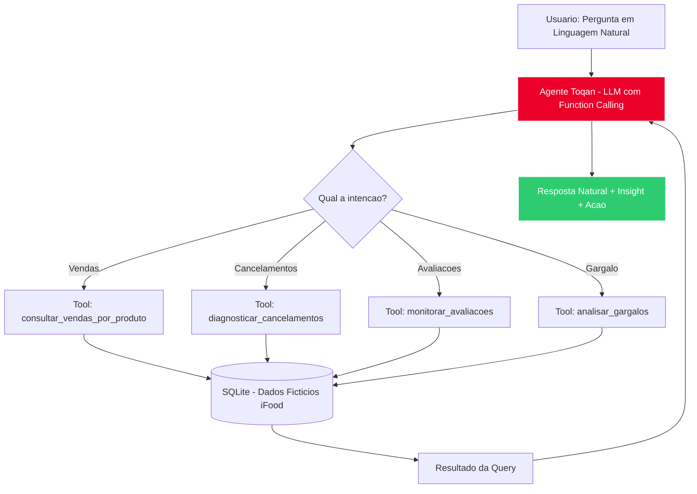
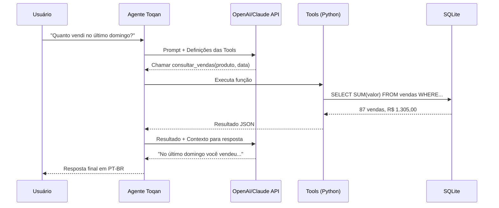

# agente-toqan-ifood-exemplo
### Agente Inteligente para Restaurantes iFood usando Toqan + Function Calling

> Exemplo prático de como criar um AI Agent no ecossistema **Toqan (iFood / Prosus)** que responde perguntas de operação em linguagem natural: vendas, cancelamentos, avaliações e gargalos.

[[Python](https://img.shields.io/badge/Python-3.11+-blue.svg)](https://python.org)
[[Toqan](https://img.shields.io/badge/Toqan-Agent-red.svg)](https://toqan.ai)
[[iFood](https://img.shields.io/badge/iFood-Move_2026-EB0029.svg)](https://ifood.com.br)
[[Stack](https://img.shields.io/badge/Stack-FastAPI%20%7C%20Function%20Calling%20%7C%20SQLite-green.svg)](#stack)

**Repo de portfólio** criado por Pedro Henrique — demonstração de AI Agents aplicado ao cenário real de restaurantes iFood, conforme anunciado no iFood Move 2026.

---

## O que é o Toqan?

O **Toqan** é a plataforma de IA generativa da Prosus / iFood lançada oficialmente em 17 de setembro no iFood Move 2026. Já são **50k+ restaurantes** cadastrados na primeira semana. Ele conecta com segurança todos os sistemas internos do iFood e serviços externos autorizados para criar agentes.

Este repo simula **como você criaria um agente Toqan** localmente, usando o mesmo padrão: Agente + Tools (Function Calling) + Dados.

## O que este agente faz?

O dono do restaurante pergunta em linguagem natural e o agente decide qual função chamar:

| Pergunta do usuário | Função acionada | O que retorna |
| :--- | :--- | :--- |
| "Quanto vendi de chopp ontem?" | `consultar_vendas_por_produto` | Vendas + ticket médio |
| "Por que meus cancelamentos subiram?" | `diagnosticar_cancelamentos` | Top motivos + horário crítico |
| "Como estão minhas avaliações?" | `monitorar_avaliacoes` | NPS, pratos com nota baixa |
| "Qual meu gargalo operacional hoje?" | `analisar_gargalos` | Tempo de preparo, fila |

Resposta final sempre em linguagem natural: _"Ontem você vendeu 87 chopes (R$ 1.305,00). Cancelamentos subiram 23% por falta de entregador das 19h-21h."_

---

## Arquitetura

### Fluxo do Agente



### Sequência de Function Calling



---

## Estrutura pronta para colar o código

Crie o repo com esta estrutura exata:

```
agente-toqan-ifood-exemplo/
├── README.md
├── requirements.txt
├── .env.example
├── toqan.yaml              # Manifesto do agente no padrão Toqan
├── main.py                 # FastAPI + Orquestrador do agente
├── /src
│   ├── /agent
│   │   ├── prompt.py       # System prompt com contexto iFood
│   │   ├── orchestrator.py # Lógica de Function Calling
│   │   └── toqan_client.py # Cliente simulado Toqan SDK
│   ├── /tools
│   │   ├── vendas.py       # consultar_vendas_por_produto
│   │   ├── cancelamentos.py# diagnosticar_cancelamentos
│   │   ├── avaliacoes.py   # monitorar_avaliacoes
│   │   └── gargalos.py     # analisar_gargalos
│   ├── /api
│   │   └── routes.py       # Endpoints /chat /metrics /health
│   └── /data
│       ├── schema.sql      # Tabelas: vendas, pedidos, avaliacoes
│       ├── seed_ficticio.py# Gera 500 vendas fictícias (LGPD safe)
│       └── database.db     # SQLite (gitignore)
├── /tests
│   ├── test_vendas.py
│   ├── test_agent.py
│   └── test_tools.py
└── /docs
    └── demo.gif
```

---

## Stack

**Core:** `Python 3.11`, `FastAPI`, `Toqan SDK (simulado)`, `OpenAI API / Anthropic API`, `Function Calling`, `SQLite`, `Pandas`

**Conceitos:** `IA Generativa (GenAI)`, `AI Agents`, `Agentes Inteligentes`, `Engenharia de Prompts`, `Automações com IA`, `APIs REST`, `Evolução de Modelos`

---

## Como rodar localmente

```bash
# 1. Clonar
git clone https://github.com/274-ctrl/agente-toqan-ifood-exemplo.git
cd agente-toqan-ifood-exemplo

# 2. Ambiente
python -m venv venv
source venv/bin/activate
pip install -r requirements.txt

# 3. Variáveis
cp .env.example .env
# Edite com sua OPENAI_API_KEY ou ANTHROPIC_API_KEY

# 4. Banco fictício
python src/data/seed_ficticio.py

# 5. Rodar API
uvicorn main:app --reload --port 8000

# Testar
curl -X POST http://localhost:8000/chat -H "Content-Type: application/json" -d '{"pergunta": "quanto vendi de chopp ontem?"}'
```

### requirements.txt sugerido
```
fastapi
uvicorn
openai
anthropic
pandas
pydantic
python-dotenv
pytest
```

### toqan.yaml - Manifesto do Agente
```yaml
name: ifood-operational-agent
display_name: "Agente Operacional iFood - Exemplo"
description: "Agente que diagnostica vendas, cancelamentos e avaliações para restaurantes parceiros"
version: 0.1.0
runtime: python-3.11
entrypoint: main:app

llm:
  provider: openai
  model: gpt-4o-mini
  tools:
    - consultar_vendas_por_produto
    - diagnosticar_cancelamentos
    - monitorar_avaliacoes
    - analisar_gargalos

permissions:
  - ifood:read:orders
  - ifood:read:reviews
  - ifood:read:metrics

triggers:
  - type: chat
  - type: webhook
    event: order.canceled
```

### main.py - Esqueleto
```python
from fastapi import FastAPI
from src.agent.orchestrator import processar_pergunta

app = FastAPI(title="Agente Toqan iFood - Exemplo")

@app.post("/chat")
async def chat(pergunta: str):
    resposta = await processar_pergunta(pergunta)
    return {"resposta": resposta}

@app.get("/health")
def health():
    return {"status": "ok", "agent": "toqan-ifood-exemplo"}
```

---

## Exemplo de Tool com Function Calling

```python
# src/tools/vendas.py
def consultar_vendas_por_produto(produto: str, data_inicio: str, data_fim: str):
    # Query real no SQLite com dados fictícios
    # Retorna JSON para o LLM formular resposta
    return {"qtd": 87, "total": 1305.00, "produto": produto}
```

Definição da Tool para OpenAI:
```json
{
  "type": "function",
  "function": {
    "name": "consultar_vendas_por_produto",
    "description": "Consulta vendas de um produto em um período",
    "parameters": {
      "type": "object",
      "properties": {
        "produto": {"type": "string"},
        "data_inicio": {"type": "string", "format": "date"},
        "data_fim": {"type": "string", "format": "date"}
      }
    }
  }
}
```

---

## Roadmap

- [x] Estrutura base + README
- [ ] Implementar 4 tools com dados fictícios
- [ ] Adicionar testes pytest (cobertura > 80%)
- [ ] Integrar Toqan SDK real quando liberado para parceiros
- [ ] Dashboard com Streamlit para demo

## LGPD

Este repo usa **100% dados fictícios** gerados via `seed_ficticio.py`. Nenhum dado real de restaurante ou cliente iFood.

---

## Autor

**Pedro Henrique** - Rio de Janeiro
- GitHub: [@274-ctrl](https://github.com/274-ctrl)
- Foco: AI Agents, GenAI, Function Calling, Python

> Este é um projeto de portfólio educacional inspirado no Toqan do iFood Move 2026. Não é afiliado oficialmente ao iFood.

### Topics para GitHub
`toqan` `ifood` `ai-agents` `genai` `function-calling` `fastapi` `python` `openai-api` `anthropic` `sales-analytics` `chatbot`
